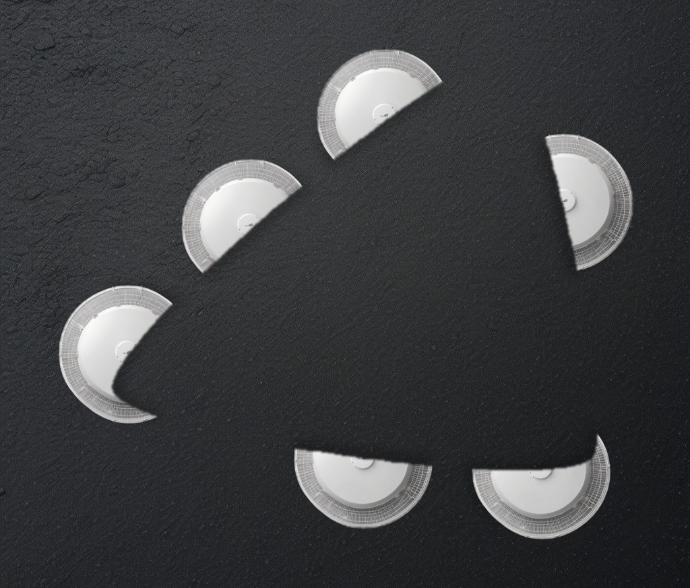
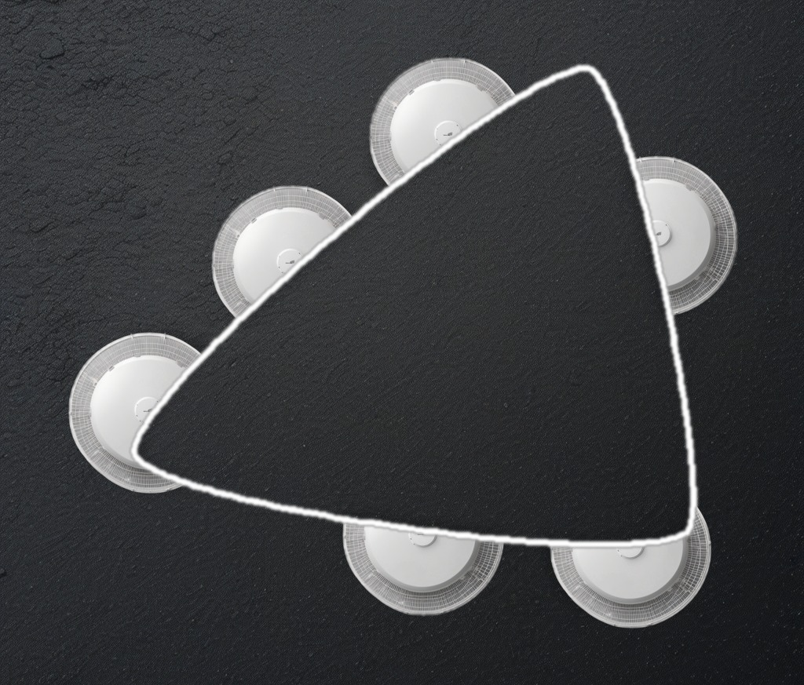
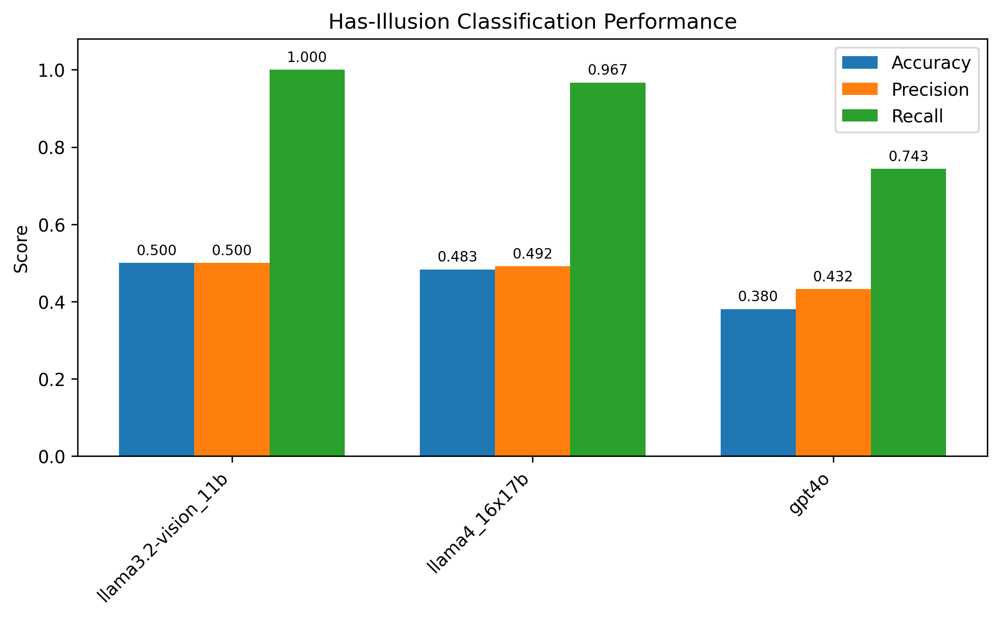
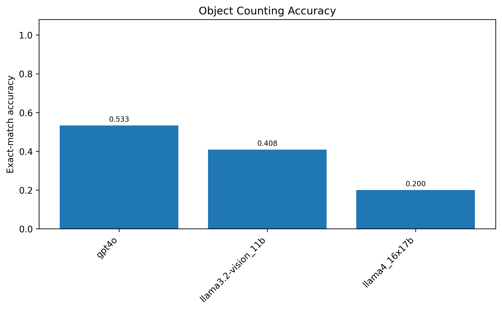
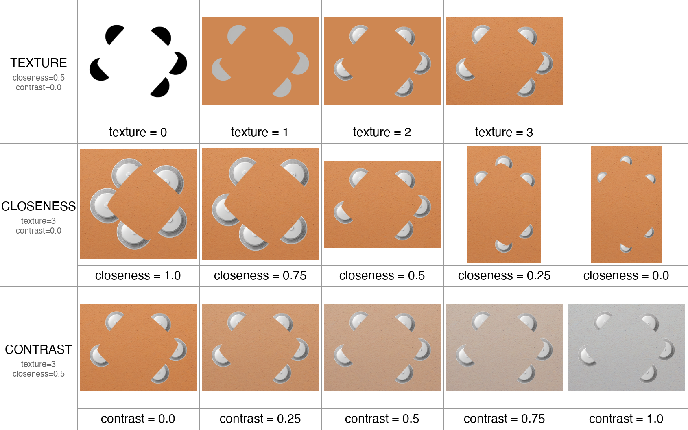

# Gestalt Generator

[](https://www.python.org/)

<p align="center">
  
  
</p>
<p align="center"><i>Left: illusory condition, the figure is only implied. Right: control, the same figure with its contour drawn.</i></p>

Gestalt Generator makes benchmark images that test whether a vision model groups separate parts into
one figure. We arrange real objects, cut like the "pac-men" of a Kanizsa figure, so that their bites
line up on a hidden polygon. A viewer sees the polygon although no pixel draws it. Every figure comes
in three matched conditions that share the same objects, count and arrangement:

| condition | what the image shows | `has_illusion` | `has_visible_contour` |
|---|---|---|---|
| `illusory` | the bites line up, the figure is implied | true | false |
| `control` | the same figure with its contour drawn | false | true |
| `negative` | the same objects moved to each other's places, so the bites share no contour | false | false |

The control shows that a model can name and count the shape when it is drawn. The negative shows
whether a model that reports a figure does so because the parts align, not because bitten discs are
present.

## Installation

```bash
pip install -r requirements.txt
```

Reproducing any shipped set is pure Python. It needs no GPU, API key or internet connection.

## Quick start

```bash
python3 run.py configs/gen100.yaml
```

This renders the shipped set: 10 figures, each dressed with 10 object pairs, in 3 conditions, for
300 images. The run writes:

```
out/comp/<condition>/<id>.png    the images, one folder per condition
out/gt/<id>.json                 the answer key of each image
out/manifest.csv                 id -> silhouette, object, background, condition
out/silhouettes/ out/control/ out/negative/   the source silhouettes used
```

Filenames are opaque hashes, so a name never encodes the answer.

**Shipped sets.** Each folder under `benchmarks/` is the output of one command, and running it
again gives the same files.

| set | command | images |
|---|---|---|
| `benchmarks/gen_100_rank/` | `python3 run.py configs/gen_100_rank.yaml` | 300: 10 ranked figures × 10 pairs × 3 conditions |
| `benchmarks/varying_difficulty_benchmark_100/` | `python3 tools/run_difficulty_set.py` then `python3 tools/export_benchmark.py out/varying_difficulty_benchmark_100 varying_difficulty_benchmark_100` | 1,800: 100 figures × 2 textures × 3 conditions × 3 levels |
| `out/` after `python3 run.py configs/closure_sweep.yaml` | the exhaustive 21,600-figure sweep for the closure score, not committed | 64,800 masks |

`benchmarks/gen100/` is an earlier rendering of the quick-start set, made with a previous object
catalog, in the illusory and control conditions only. It is kept as is and cannot be regenerated.

## The task

A model shown an image reports what the answer key records:

```json
{
  "id": "stim_bec2bca3aa",
  "condition": "control",
  "n_inducers": 6,
  "has_illusion": false,
  "has_visible_contour": true,
  "illusory_shape": "irregular",
  "polygon_vertices": 3,
  "nonillusory_shapes": {"real_life": ["satellite dish", "..."], "primitive": ["circle", "..."]},
  "difficulty": {"texture": 3, "closeness": 0.5, "closeness_measured": 0.55,
                 "support_ratio": 0.47, "contrast": 0.25, "lum_gap": 0.11}
}
```

| field | question it answers |
|---|---|
| `n_inducers` | how many objects are present |
| `has_illusion` | whether an implied figure is seen |
| `illusory_shape` | what the figure is (`irregular` for bezier polygons, `triangle` and so on for Kanizsa figures) |
| `polygon_vertices` | how many corners the hidden polygon has |
| `nonillusory_shapes` | what the objects are, and their geometric primitive |
| `difficulty` | the settings that made the image easy or hard, see [Difficulty](#difficulty) |

## Evaluation

`ollama_eval.py` asks a vision model two questions about every image in a set and writes the answers
as JSON. `evaluate.py` scores those answers against the keys and plots accuracy, precision and recall.

```bash
python3 ollama_eval.py --model llama3.2-vision:11b          # a model served by Ollama, on out/comp
python3 evaluate.py                                         # scores every file in outs/
python3 evaluate.py --gt_folder benchmarks/varying_difficulty_benchmark_100/hard/answers
```

<p align="center">
  
  
</p>

**Closure score.** `src/eval/run_eval.py` scores image-classification backbones without any prompt.
For every figure it embeds the illusory image, the drawn contour alone and the negative, then takes
the cosine similarity of the illusory image to the contour minus that of the negative to the contour.
A model whose features treat the implied figure like the drawn one scores high.

```bash
pip install -r requirements-eval.txt
python3 run.py configs/closure_sweep.yaml                                   # 21,600 figures in out/
python3 -m src.eval.run_eval --data_root out --models resnet50 vit_base_patch16_224
python3 -m src.eval.run_eval --data_root out                                # every model in assets/results-imagenet.csv
```

## Make your own set

One YAML file defines a set. Copy `configs/gen100.yaml`, edit, and run `python3 run.py configs/your.yaml`.

```yaml
seed: 1                                            # one seed makes the whole run reproducible
silhouettes:                                       # where the figures come from, see below
  - {type: gestalt, params: {mode: rank, n: 10}}
pairs:
  source: catalog                                  # 15 validated object/background pairs
  select: random
  n_per_silhouette: 10
dress:
  backends: [composite]
  conditions: [illusory, control, negative]
  contour: auto                                    # colour of the drawn contour: auto | white | black
  texture: 3                                       # difficulty, see below
  contrast: null                                   # difficulty, see below
  shadow: 0                                        # drop shadow under each object, a depth cue
  feather: 1.5                                     # softness of the cutout edge in px
```

The number of images is figures × `n_per_silhouette` × conditions.

### Where figures come from

| type | what it does | parameters |
|---|---|---|
| `gestalt` | pick from the stored pool `data/silhouettes/` | `mode: rank` takes the `n` best by contour quality, `mode: random` a seeded sample; `inducers: [3, 4]` limits the count |
| `kanizsa` | a clean regular polygon with pac-man inducers | `n_sides` |
| `dropin` | files you put in `data/silhouettes/` | `files` |
| `generate` | render new figures | the table below |

Every figure in the store gets a control (`data/control/`) and a negative (`data/negative/`). The
negative is built from the stored image by moving each inducer to another inducer's place, under the
run's seed. Sweep figures (`rng: shared`) instead permute the disc positions in the figure's own
random stream, which can leave some discs where they were; this keeps the sweep identical to the
closure data it reproduces.

### `type: generate`

A figure is a bezier polygon with discs placed on its contour, each disc bitten by the polygon. Five
knobs describe it, and `space` lists the values each knob may take, as a list or a `{min, max}`
range to sample. Knobs you leave out keep the defaults below.

| knob | meaning | default values |
|---|---|---|
| `polygon_randomness` | 0 is a regular polygon, 1 a strongly deformed one | 0, 0.4, 0.8, 1 |
| `n_vertices` | corners of the hidden polygon | 3 to 8 |
| `n_inducers` | number of discs | 3 to 6 |
| `corner_sharpness` | low rounds the corners, high keeps them sharp | 0.1, 0.5, 1 |
| `side_bulge` | how far each side bows out between corners | 0.1, 0.2, 0.4 |
| `inducer_radius` | disc radius in px, written inside `space` or beside it. `derived` means 3 × `inducer_scale` / `n_inducers`, so 3 discs of radius 125 or 6 of radius 62 at the default scale. A list sweeps the radius as its own factor, skipping radii above the derived one | `derived` |

How many figures, and how they are drawn and kept:

| parameter | meaning | default |
|---|---|---|
| `n_figures` | how many figures. A number draws from `space` until that many pass the filter. `all` renders every combination of the lists | required |
| `figures_per_combination` | with `n_figures: all`, random figures per combination | 1 |
| `inducer_count_mix` | with a numeric `n_figures`, the share of each inducer count, as `{3: 0.15, 4: 0.35, 5: 0.35, 6: 0.15}`. Fractions are shares, renormalised to 1. Whole numbers are counts and must sum to `n_figures`. `uniform` spreads equally over the counts the filter accepts | `uniform` |
| `figures` | instead of `n_figures`: pinned rows `[randomness, n_vertices, n_inducers, corner_sharpness, side_bulge, seed]` | |
| `polygon_size` | size of the hidden polygon in px, inside the 1024 × 1024 canvas | `[700, 700]` |
| `inducer_scale` | sets the derived disc radius, 3 × `inducer_scale` / `n_inducers` | 125 |
| `inducer_closeness` | bite depth when the radius is derived: 0 leaves the discs far apart, 1 brings them nearly touching | 0.5 |
| `also_closeness` | render the same figures at these further closeness values too, for matched easy and hard sets | `[]` |
| `contour_px` | width of the drawn contour in the control | 5 |
| `quality_filter` | `true` rejects weak figures, `false` keeps all, a dict changes the thresholds (next section) | `true` |
| `rng` | `fresh` restarts from the seed at each step, so one seed gives the same polygon at every closeness. `shared` uses one stream per figure for polygon, placement and negative, for large sweeps | `fresh` |
| `indices` | with `n_figures: all`, render only these positions of the sweep, for example a few figures to dress | all |
| `max_seeds` | with a numeric `n_figures`, how many seeds to try per row before giving up | 200 |
| `jobs` | worker processes | all cores but one |


Two shipped examples: `configs/closure_sweep.yaml` renders every combination with four disc radii,
ten times each, with no filter, and `configs/closure_sweep_dressed.yaml` draws 60 filtered figures
and dresses them in all three conditions.

**Quality filter.** We keep a figure only if its mask has exactly as many separate blobs as inducers,
every inducer shows a concave bite, and the inducers surround the figure. The thresholds are
`min_inducers`, `flat_solidity` with `max_flat_frac` (an inducer whose area over its convex hull
exceeds `flat_solidity` was cut by a straight edge, and at most that fraction of them may be),
`all_sides` (inducers in all four quadrants) or `max_gap` (no gap wider than that multiple of even
spacing). Figures that pass are ranked by spacing, equal distance from the centre, frame coverage and
bite depth. `tools/rank_silhouettes.py` prints the ranking of the stored pool.

## Difficulty

Three settings change one property of an image and hold the rest fixed. Re-render the figure below
with `python3 tools/make_difficulty_examples.py`.

<p align="center"></p>

| setting | range | what it controls |
|---|---|---|
| `inducer_closeness` | 0 to 1 | disc size along the contour. The radius is `min + closeness · (max − min)`, where `max` is the largest radius at which the discs still fit without touching. Larger discs leave smaller gaps, so the figure is easier to see |
| `texture` | 0, 1, 2, 3 | realism. 0 black discs on a flat background, 1 solid colours, 2 real objects on a solid background, 3 real objects on a real background |
| `contrast` | 0 to 1 | how far the background is recoloured toward the object. At 1 the objects nearly vanish |

Closeness is set when figures are generated, texture and contrast when they are dressed. The answer
key records the values and what they produced: `closeness_measured`, the mean closeness between
neighbouring discs, `support_ratio`, the fraction of the contour traced by discs, and `lum_gap`, the
remaining luminance difference between object and background.

**Matched levels.** To test the same figures at several closeness values, pick them once, judged at
the middle level and required to fit at the others, then write one config per level. The picker's
defaults are the settings of the shipped set, so the first command below returns its 100 rows:

```bash
python3 tools/pick_difficulty_figures.py --n 100 --judge 0.5 --levels 0.25 0.75
python3 tools/make_difficulty_configs.py --name varying_difficulty_benchmark_100 --levels easy=0.75,0.0 normal=0.5,0.0 hard=0.25,0.5
python3 tools/run_difficulty_set.py --name varying_difficulty_benchmark_100
python3 tools/export_benchmark.py out/varying_difficulty_benchmark_100 varying_difficulty_benchmark_100
```

The export lays a set out as `benchmarks/<name>/<level>/<plain|texture>_<illusory|contour|negative>/f017_texture_illusory.jpg`,
where `f017` is the same figure in every level, variant and condition, with `answers.csv` and a
preview per level. `benchmarks/varying_difficulty_benchmark_100/` is such a set. Evaluate one level with
`python3 ollama_eval.py --model <m> --data_dir benchmarks/varying_difficulty_benchmark_100/hard --variant texture`.

<details>
<summary><b>New objects and backgrounds (needs a model)</b></summary>

The catalog is fixed. To add textures, name a provider in the config and supply its credentials.
New pairs are checked for round shape and colour contrast before use. Backgrounds are uniform
material surfaces, so the background never confounds the figure.

- `hf_api`: HuggingFace Inference API. `pip install -r requirements-hf.txt`, `export HF_TOKEN=...`
- `modal_hf`: SDXL on a Modal GPU. `pip install -r requirements-modal.txt`, `modal deploy app.py`
- your own: copy `pipeline/providers/template.py` and set `provider: "yourmodule:YourClass"`

</details>

## Reproducibility

Two stochastic models are involved, a language model that proposed object/background pairs and a
diffusion model that rendered them. We ship their frozen output, the validated pairs in
`pipeline/pairs_catalog.yaml` and the cutouts in `data/assets/`. Every other step is seeded, so one
seed gives the same images on any machine. The stored silhouette pool predates seeding and is
committed as files. New figures made with `type: generate` are reproducible from their config.

## Tests

```bash
python3 -m pytest -q                  # fast suite, no network, no model
python3 -m pytest -q --run-slow       # adds the end-to-end run of run.py
```
