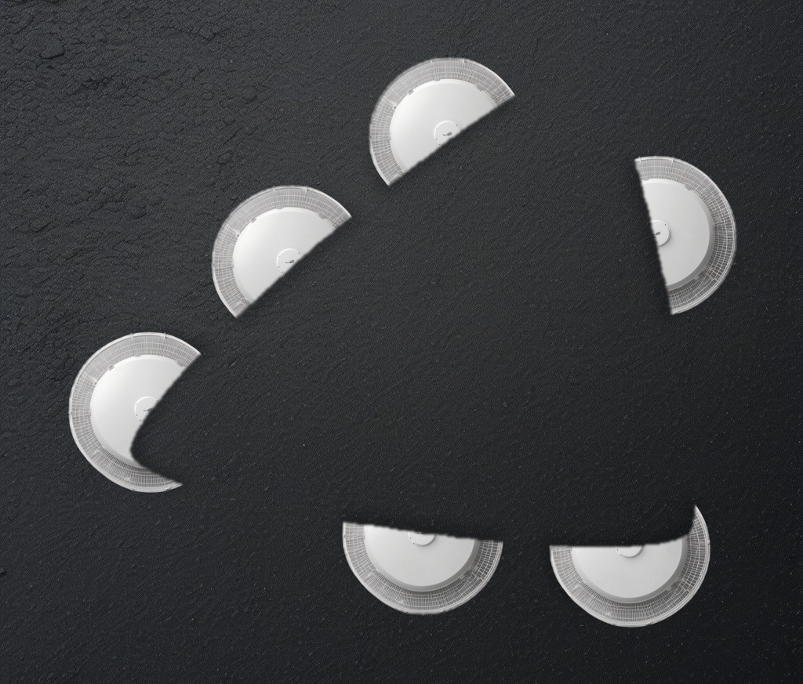
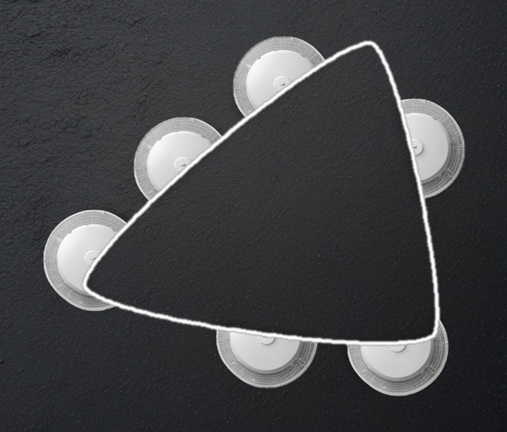
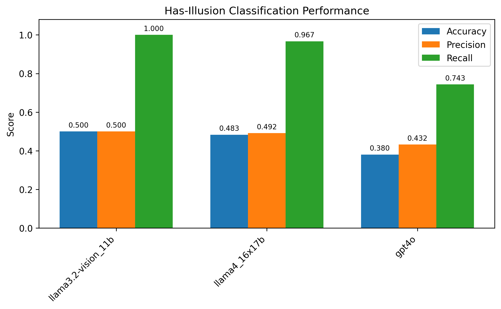
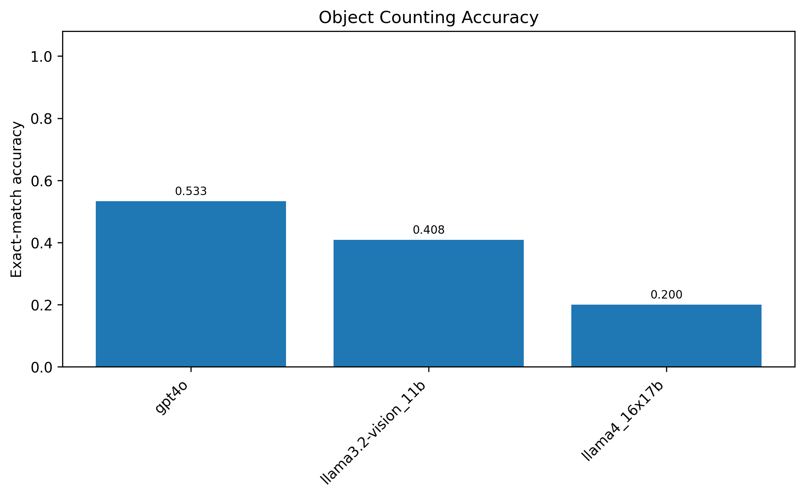

# Gestalt Generator

[](https://www.python.org/)

<p align="center">
  
  
</p>
<p align="center"><i>Left: illusory condition (the triangle is only implied). Right: matched control (the same figure with its contour drawn).</i></p>

**Gestalt Generator** produces benchmark stimuli that test perceptual grouping in vision models.
Perceptual grouping — binding separate elements into a whole — underlies how we perceive objects and
contours, and the *Kanizsa* figure is its classic probe: several "pac-man" inducers, arranged so their
bitten edges align, evoke a shape whose contour is never drawn. We build these figures from **real
objects** rather than abstract discs, and ship each figure in two matched conditions — **illusory** (no
contour) and a positive-**control** with the shape's contour drawn — so a model that fails on the
illusory version can be distinguished from one that simply cannot name or count the shape. Every
stimulus carries a machine-readable answer key, and the set reproduces from a single command, offline,
without a GPU or an API key.

*This repository covers stimulus generation. An evaluation harness will follow separately.*

## Installation

```bash
pip install -r requirements.txt
```

The reproduction path is pure Python and needs no GPU, API key, or internet connection.

## Quick start

We ship a fixed set of 200 stimuli — 100 figures, each in the illusory and control conditions. To
regenerate it exactly — the configuration pins `seed: 1` — run:

```bash
python3 run.py configs/gen100.yaml
```

This writes to `out/`:

```
out/comp/illusory/<id>.png    100 illusory stimuli
out/comp/control/<id>.png     100 control stimuli (contour drawn)
out/gt/<id>.json              one answer key per image (carries `condition`)
out/manifest.csv              id -> silhouette / object / background / condition
out/silhouettes/  out/control/   the source silhouettes used, split like the input
```

Filenames are opaque hashes, so the answer is not encoded in the name; each image is joined to its
answer key by `id`. A rendered preview of the set is committed under `examples/gen100/`.

## The task

We consider a task where a model, shown a stimulus, must report what is recorded in its answer key
`out/gt/<id>.json`:

```json
{
  "id": "stim_bec2bca3aa",
  "condition": "control",
  "n_inducers": 6,
  "has_illusion": false,
  "has_visible_contour": true,
  "illusory_shape": "irregular",
  "polygon_vertices": 3,
  "nonillusory_shapes": {
    "real_life": ["satellite dish", "satellite dish", "satellite dish", "satellite dish", "satellite dish", "satellite dish"],
    "primitive": ["circle", "circle", "circle", "circle", "circle", "circle"]
  }
}
```

Each field states one question the model should answer:

| Field | Question |
|---|---|
| `n_inducers` | how many objects are present |
| `has_illusion` | whether an illusory figure appears |
| `illusory_shape` | what the illusory figure is (`irregular` for bezier figures) |
| `polygon_vertices` | the figure's vertex count — a deterministic shape descriptor |
| `nonillusory_shapes.real_life` | what the real objects are |
| `nonillusory_shapes.primitive` | their geometric primitive |

Each figure appears in two `condition`s that share the same objects, count, and shape, differing only
in whether the contour is drawn:

- **`illusory`** — the shape is only induced (`has_illusion: true`, `has_visible_contour: false`).
- **`control`** — the shape's contour is drawn (`has_illusion: false`, `has_visible_contour: true`).

The control is a positive control: it isolates perception of the illusory contour from the ability to
name and count the shape. The shipped set uses bezier figures, so `illusory_shape` is always
`"irregular"`; for named shapes (`triangle`, `square`, …), use a Kanizsa configuration below.

An example of running the tasks on models from Ollama:

```bash
python ollama_eval.py --model llama3.2-vision:11b
```
This script evaluates both the illusory and control images with two prompts and gets output in JSON format:

```python
"""
Inspect the image. Report every visually distinc form a human inspecting the image would perceive.
Count repeated forms separately. Use a short conventional name for each form. Do not explain your answer.
"""
"""
Inspect the image. Is there a true or illusory contour? Do not explain your answer.
"""

Output format:
```json
{
  "illusory": {
    "img_name.jpg":{
      "0": {
        "has_illusion": true, # Whether there is an illusory contour.
        "n_objects": 3 # Number of objects in the image, including the illusory shape. 
        "visible_shapes": [ # Name the shapes counted in the objects
          "square",
          "circle",
          ...
        ]
      }
    }
  }
  "control":{
  ...
  }
}
```

```

Bash script to evaluate multiple models:

```bash
sh run.sh
```

## Evaluation
We provide an example script for computing accuracy, precision, and recall across all model outputs in the outs folder. 
The script will plot all model results in bar plots.

```bash
python evaluate.py
````
<p align="center">
  
  
</p>
<p align="center"><i>Results example</i></p>

## Generate new silhouettes

New silhouettes can be randomly generated with control over the number of vertices, number of inducers, and the smoothness of the illusory contour.

```bash
python create_template.py
```
Outputs grayscale illusory contour templates along with controls that draw the illusory contour explicitly.

## Make your own set

Each benchmark is defined by one configuration file. To create your own, copy `configs/gen100.yaml`,
edit the fields below, and run `python3 run.py configs/your.yaml`.

```yaml
seed: 1                                              # any seed gives a reproducible draw
silhouettes:
  - {type: gestalt, params: {mode: rank, n: 10}}     # mode: rank picks the N best silhouettes;
                                                     # random = seeded sample; or {type: kanizsa, params: {n_sides: 3}}
pairs:
  source: catalog                                    # object/background pairs (pipeline/pairs_catalog.yaml)
  select: random
  n_per_silhouette: 10
dress:
  backends: [composite]                              # composite real objects into the figure
  conditions: [illusory, control]                    # matched pair per figure (drop control for illusory-only)
  contour: auto                                      # control-outline colour: auto | white | black
  shadow: 55
  feather: 1.5
```

The number of stimuli is `#silhouettes × n_per_silhouette × #conditions`. Textures are drawn from a
catalog of 16 pre-validated object/background pairs.

**Selecting silhouettes.** `mode: rank` keeps the `n` silhouettes with the crispest illusory contour
and the most regular full-frame coverage — inducers evenly spaced around the centre, spanning all
sides — scored geometrically from the mask (no model). `mode: random` takes a seeded random sample;
`type: dropin` pins exact files. The ranking is shared with `tools/rank_silhouettes.py`, which prints
the ordered list (`python3 tools/rank_silhouettes.py`). `configs/gen_100_rank.yaml` is a ready-made
`mode: rank` set of 200 stimuli (100 figures); a rendered preview is committed under
`examples/gen_100_rank/`.

<details>
<summary><b>Generate new objects and backgrounds (requires a model)</b></summary>

The catalog is fixed. To introduce new textures, name a provider in the configuration and supply its
credentials; the rest of the pipeline is unchanged. New pairs are validated for round shape and colour
contrast before use.

- **`hf_api`** — HuggingFace Inference API. `pip install -r requirements-hf.txt`, `export HF_TOKEN=...`
- **`modal_hf`** — SDXL on a Modal GPU. `pip install -r requirements-modal.txt`, `modal deploy app.py`
- **your own** — copy `pipeline/providers/template.py` and set `provider: "yourmodule:YourClass"`

</details>

## Reproducibility

Stimuli are assembled from two stochastic, GPU-bound models — a language model that proposes
object/background pairs, and a diffusion model that renders them. To make the set reproducible we ship
their frozen output: the proposed pairs that passed validation (`pipeline/pairs_catalog.yaml`) and the
rendered cutouts (`data/assets/`). Every remaining step — which silhouettes and pairs are selected, and
how objects are composited — is seeded and deterministic, so `seed: 1` yields the identical set on any
machine. The silhouettes and their matched controls are regenerated with `python3 main.py`.


