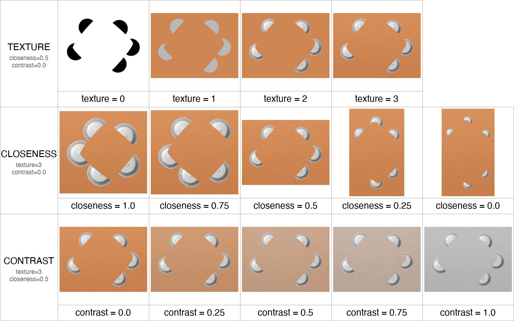

# Gestalt Generator

[](https://www.python.org/)

<p align="center">
  
  
</p>
<p align="center"><i>Left: illusory condition (the triangle is only implied). Right: matched control (the same figure with its contour drawn).</i></p>

**Gestalt Generator** produces benchmark stimuli that test perceptual grouping in vision models.
Perceptual grouping — binding separate elements into a whole — underlies how we perceive objects and
contours. One of the classic shapes is the *Kanizsa* figure where several "pac-man" objects are arranged such that their
bitten edges evoke a shape of a triangle. We build these figures from novel configurations and add texture using **real
objects** and **real backgrounds**. Each figure comes in two matched conditions — **illusory** (no
contour) and a positive-**control** with the shape's contour drawn. In this way, we control the model's ability to match patterns based on shapes and configuration of the objects in the scene, as well as count or name shapes.

## Installation

```bash
pip install -r requirements.txt
```

The reproduction path is pure Python and needs no GPU, API key, or internet connection.

## Quick start

We ship a fixed set of 200 stimuli — 100 figures, each in the illusory and control conditions. To
regenerate it exactly — the configuration pins `seed: 1` — run:

```bash
python3 run.py configs/gen100.yaml
```

This writes to `out/`:

```
out/comp/illusory/<id>.png    100 illusory stimuli
out/comp/control/<id>.png     100 control stimuli (contour drawn)
out/gt/<id>.json              one answer key per image (carries `condition`)
out/manifest.csv              id -> silhouette / object / background / condition
out/silhouettes/  out/control/   the source silhouettes used, split like the input
```

Filenames are opaque hashes, so the answer is not encoded in the name; each image is joined to its
answer key by `id`. A rendered preview of the set is committed under `examples/gen100/`.

## The task

We consider a task where a model, shown a stimulus, must report what is recorded in its answer key
`out/gt/<id>.json`:

```json
{
  "id": "stim_bec2bca3aa",
  "condition": "control",
  "n_inducers": 6,
  "has_illusion": false,
  "has_visible_contour": true,
  "illusory_shape": "irregular",
  "polygon_vertices": 3,
  "nonillusory_shapes": {
    "real_life": ["satellite dish", "satellite dish", "satellite dish", "satellite dish", "satellite dish", "satellite dish"],
    "primitive": ["circle", "circle", "circle", "circle", "circle", "circle"]
  }
}
```

Each field states one question the model should answer:

| Field | Question |
|---|---|
| `n_inducers` | how many objects are present |
| `has_illusion` | whether an illusory figure appears |
| `illusory_shape` | what the illusory figure is (`irregular` for bezier figures) |
| `polygon_vertices` | the figure's vertex count — a deterministic shape descriptor |
| `nonillusory_shapes.real_life` | what the real objects are |
| `nonillusory_shapes.primitive` | their geometric primitive |

The answer key also carries a `difficulty` block recording how hard the stimulus was made to be —
see [Difficulty knobs](#difficulty-knobs).

Each figure appears in two `condition`s that share the same objects, count, and shape, differing only
in whether the contour is drawn:

- **`illusory`** — the shape is only induced (`has_illusion: true`, `has_visible_contour: false`).
- **`control`** — the shape's contour is drawn (`has_illusion: false`, `has_visible_contour: true`).

The control is a positive control: it isolates perception of the illusory contour from the ability to
name and count the shape. The shipped set uses bezier figures, so `illusory_shape` is always
`"irregular"`; for named shapes (`triangle`, `square`, …), use a Kanizsa configuration below.

An example of running the tasks on models from Ollama:

```bash
python ollama_eval.py --model llama3.2-vision:11b
```
This script evaluates both the illusory and control images with two prompts and gets output in JSON format:

```python
"""
Inspect the image. Report every visually distinc form a human inspecting the image would perceive.
Count repeated forms separately. Use a short conventional name for each form. Do not explain your answer.
"""
"""
Inspect the image. Is there a true or illusory contour? Do not explain your answer.
"""

Output format:
```json
{
  "illusory": {
    "img_name.jpg":{
      "0": {
        "has_illusion": true, # Whether there is an illusory contour.
        "n_objects": 3 # Number of objects in the image, including the illusory shape. 
        "visible_shapes": [ # Name the shapes counted in the objects
          "square",
          "circle",
          ...
        ]
      }
    }
  }
  "control":{
  ...
  }
}
```

```

Bash script to evaluate multiple models:

```bash
sh run.sh
```

## Evaluation
We provide an example script for computing accuracy, precision, and recall across all model outputs in the outs folder. 
The script will plot all model results in bar plots.

```bash
python evaluate.py
````
<p align="center">
  
  
</p>
<p align="center"><i>Results example</i></p>

## Generate new silhouettes

New silhouettes can be randomly generated with control over the number of vertices, number of inducers, and the smoothness of the illusory contour.

```bash
python create_template.py
```
Outputs grayscale illusory contour templates along with controls that draw the illusory contour explicitly.

## Make your own set

Each benchmark is defined by one configuration file. To create your own, copy `configs/gen100.yaml`,
edit the fields below, and run `python3 run.py configs/your.yaml`.

```yaml
seed: 1                                              # any seed gives a reproducible draw
silhouettes:
  - {type: gestalt, params: {mode: rank, n: 10}}     # mode: rank picks the N best silhouettes;
                                                     # random = seeded sample; or {type: kanizsa, params: {n_sides: 3}}
pairs:
  source: catalog                                    # object/background pairs (pipeline/pairs_catalog.yaml)
  select: random
  n_per_silhouette: 10
dress:
  backends: [composite]                              # composite real objects into the figure
  conditions: [illusory, control]                    # matched pair per figure (drop control for illusory-only)
  contour: auto                                      # control-outline colour: auto | white | black
  texture: 3                                         # difficulty knob, see below
  contrast: null                                     # difficulty knob, see below (null = native colours)
  shadow: 0                                          # optional inward depth cue (e.g. 55)
  feather: 1.5
```

The number of stimuli is `#silhouettes × n_per_silhouette × #conditions`. Textures are drawn from a
catalog of 15 pre-validated object/background pairs.

## Difficulty knobs

We control the difficulty of a stimulus with three parameters. Each parameter varies one property
of the image and holds the rest fixed. The sweep below shows each parameter on one figure: one row
per parameter, easy on the left, hard on the right. To re-render it, run
`python3 tools/make_difficulty_examples.py`.

<p align="center">
  
</p>
<p align="center"><i>Per-parameter sweeps: texture (rendering realism), closeness (inducer size), and contrast (background recolored toward the object). The row labels list the values held fixed.</i></p>

| Parameter | Range | What it controls |
|---|---|---|
| `closeness` | [0, 1] | The size of the inducers. We set the inducer radius to `min + closeness·(max − min)`, where `max` is the largest radius at which the inducers fit on the contour without touching. Larger inducers leave smaller gaps along the illusory contour, so the illusion is easier to see. |
| `texture` | {0, 1, 2, 3} | The realism of the rendering. 0: black inducers on a flat background. 1: solid-color inducers on a solid background. 2: real objects on a solid background. 3: real objects on a real background. |
| `contrast` | [0, 1] | How far the background is recolored toward the object's color. At 0 (the default, `null`), the pair keeps its native colors. At 1, the background matches the object's mean color and the inducers nearly disappear. |

`closeness` is set at silhouette generation (`main.generate`); `texture` and `contrast` are set at
dressing time (`dress.texture`, `dress.contrast`). A fourth setting, `dress.shadow` (default 0),
adds a drop shadow under each inducer; the shadow is a depth cue that makes the figure easier to
see at any difficulty.

Each answer key records the parameter values and the quantities they induce in a `difficulty`
block. We report `closeness_measured`, the mean closeness between neighboring inducers (1 =
touching); `support_ratio`, the fraction of the illusory contour traced by the inducers; and
`lum_gap`, the remaining luminance gap between the background and the objects.

```json
"difficulty": {
  "texture": 3,
  "closeness": 0.5,
  "closeness_measured": 0.55,
  "support_ratio": 0.47,
  "contrast": 0.25,
  "lum_gap": 0.11
}
```

To generate silhouettes at chosen closeness values, pass `closenesses: [0.25, 0.5, 1.0]` to
`main.generate`, or call `main.generate_one` directly (see `tools/make_difficulty_examples.py`).
The closeness value is appended to the silhouette filename, and each silhouette gets a JSON
sidecar with its measured values.

**Selecting silhouettes.** `mode: rank` keeps the `n` silhouettes with the crispest illusory contour
and the most regular full-frame coverage — inducers evenly spaced around the centre, spanning all
sides — scored geometrically from the mask (no model). `mode: random` takes a seeded random sample;
`type: dropin` pins exact files. The ranking is shared with `tools/rank_silhouettes.py`, which prints
the ordered list (`python3 tools/rank_silhouettes.py`). `configs/gen_100_rank.yaml` is a ready-made
`mode: rank` set of 200 stimuli (100 figures); a rendered preview is committed under
`examples/gen_100_rank/`.

<details>
<summary><b>Generate new objects and backgrounds (requires a model)</b></summary>

The catalog is fixed. To introduce new textures, name a provider in the configuration and supply its
credentials; the rest of the pipeline is unchanged. New pairs are validated for round shape and colour
contrast before use. Backgrounds are prompted as uniform full-frame material surfaces (stone, wood,
sand, moss, felt, terrazzo, …) with no bounded objects or geometric patterns, so the background never
confounds recognition of the illusory figure.

- **`hf_api`** — HuggingFace Inference API. `pip install -r requirements-hf.txt`, `export HF_TOKEN=...`
- **`modal_hf`** — SDXL on a Modal GPU. `pip install -r requirements-modal.txt`, `modal deploy app.py`
- **your own** — copy `pipeline/providers/template.py` and set `provider: "yourmodule:YourClass"`

</details>

## Reproducibility

Stimuli are assembled from two stochastic, GPU-bound models — a language model that proposes
object/background pairs, and a diffusion model that renders them. To make the set reproducible we ship
their frozen output: the proposed pairs that passed validation (`pipeline/pairs_catalog.yaml`) and the
rendered cutouts (`data/assets/`). Every remaining step — which silhouettes and pairs are selected, and
how objects are composited — is seeded and deterministic, so `seed: 1` yields the identical set on any
machine. The silhouettes and their matched controls are regenerated with `python3 main.py`.


